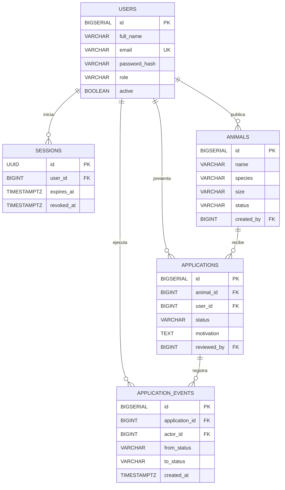

# EP2.2 — Modelo relacional de PatitasGo

Fuente: `backend/sql/schema.sql`. No se utiliza ORM; PostgreSQL almacena los datos de manera relacional.



El diagrama presenta los atributos principales. El archivo SQL define también fotografías, salud, fechas, refugio, ubicación y motivos de revisión.

## Integridad de datos

- PK y FK impiden referencias inválidas entre usuarios, animales, postulaciones e historial.
- `users.email` es único; `(animal_id, user_id)` también es único en postulaciones.
- Restricciones `CHECK` validan especies, tamaños, roles, estados y longitud de campos obligatorios.
- Índices en sesiones por usuario, postulaciones por usuario y catálogo.
- Los registros de historial se crean dentro de transacciones de PostgreSQL.
- La API consulta postulaciones de otros usuarios solo cuando el rol lo permite.
- `DELETE /api/animals/:id` archiva lógicamente el animal.

Para mostrar el esquema en Codespaces, sin alterar datos:

```bash
docker exec patitasgo-postgres psql -U postgres -d patitasgo -c '\dt'
docker exec patitasgo-postgres psql -U postgres -d patitasgo -c '\d applications'
```

**Precaución:** el esquema de la rama `backend` de `Panchiky` es otro modelo con nombres y relaciones distintas. No ejecutar sus scripts SQL en la misma base de datos sin plan de migración.
